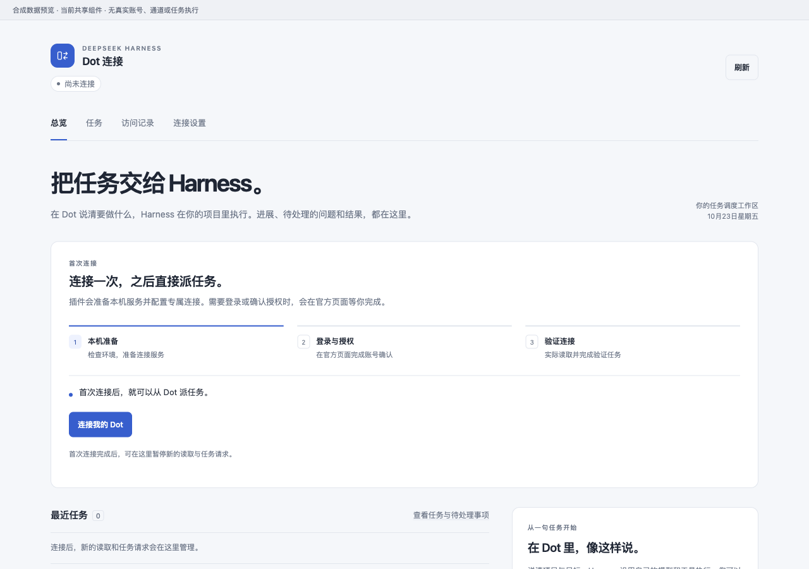
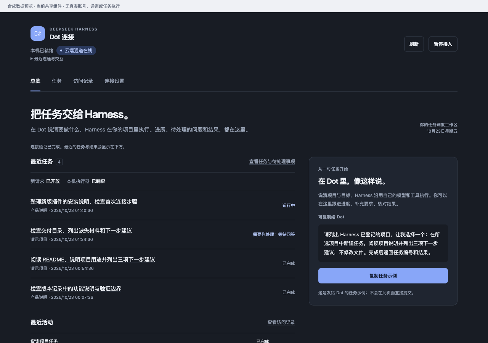

# 0.6：把首次连接收进插件

当前预览版：`0.6.0-preview.12`（2026-10-23）。已通过 Harness 官方界面安装并启用，54 个文件与源码及归档一致；安装后的真实 Dot 成功读取项目并完成恰好一个关联验证任务，管理页自动显示云端在线。Ego 安装分支另通过真实隔离实测。正式仓库源码已上传并逐文件核验，下载入口为 [v0.6.0-preview.12 发行页](https://github.com/oxmumu3/dot-dsh-connector/releases/tag/v0.6.0-preview.12)。

Dot 连接现在围绕两件事组织：首次接通自己的账号，以及日常查看 Harness 正在做什么。

首次打开时，主操作是「连接我的 Dot」。插件准备本机服务，在 ego lite 中接续官方连接页面；你在官方页面登录自己的账号，确认组织 / workspace 和最终授权。插件自动填写受支持的配置，建立通道，再通过真实项目读取和一个只回复标记的原生任务验证连接。无需在聊天中传递密钥、复制通道 ID 或运行配置命令。

preview.12 把缺少 Ego 时的准备也收进插件：点击「安装 Ego 并继续」，由插件下载官方安装包、核验签名并安装；本人完成 Ego 首次设置，再点「我已完成，继续连接」。已有 Ego 会先检查是否就绪，已有应用和连接资料会保留。安装模块回归 31/31 通过；真实隔离实测已走完官方缓存安装包校验、挂载、复制、签名与系统安全检查及卸载映像。仅最后打开应用被拦截，现有 Ego 未改动；GUI 首次设置和完全空白机器仍未验收。

连接完成后，首页以最近任务和待处理事项为主。「任务」「访问记录」「连接设置」各自保留清晰入口。任务详情支持继续、排队、补充指令、取消、归档和打开 Harness 原生会话；自动刷新不会打断正在填写的内容。

## 交互与视觉

界面采用雾白 / 石墨底色、少量蓝色重点、清晰字号和细分隔线。首次连接、登录等待、验证、恢复和失败分别显示下一步，不堆叠高级配置。窄屏优先呈现任务，详情打开后自动定位；支持明暗主题、键盘焦点与减少动态效果。

## 安装与使用

在上述发行页下载 `dot-dsh-management-0.6.0-preview.12.tgz`，交给 Harness 安装，打开「Dot 连接」，点击「连接我的 Dot」，按提示完成必要的浏览器设置、登录和授权。源码快照不等于发布回执，下载资产可用性以固定版本发行页为准。

已连接的用户保留原来的连接和任务。新版不会自动重建已有的外部通道。新流程建立的连接在重启后恢复自己的通道，并展示上次完整验证时间；重新验证由你主动发起。

## preview.13 候选增强

- 异常退出后恢复已启用连接，保护仍在运行的其他实例；Host 退出时回收自己的 Tunnel 子进程。
- 提前 7 天显示预计到期提醒，提供「更新连接授权」；新授权验证成功后才替换旧值。
- 密钥保存窗口丢失与 Ego 工作空间被删除均提供自助恢复入口。
- 安装指令直接包含公开归档地址，由 Harness 创造模式的官方插件管理工具下载；用户安装后打开侧栏开始连接。

候选功能的实际安装、公开下载与完整流程验收尚待记录；不能沿用 preview.12 的实测当成本版通过。

## 已知边界

- 这是预览版。当前支持标准安装路径的 macOS Harness Desktop `0.2.1-rc.2`。
- 首次连接使用 ego lite；缺少时按插件提示安装并完成首次设置。官方 Tunnel 组件由插件准备，登录、验证码和最终授权仍由账号本人完成。
- 本轮已通过官方「添加账户 → 使用 Google 继续 → 使用其他账号」完成本人交互登录，并回读到已登录的 ChatGPT 页面。此前独立 Chromium 的拒绝没有在这次 Ego 登录中出现。这不代表完全空白浏览器、全新账号或所有账号权限均已通过验收。
- 官方页面改版、组织策略或权限不足会停止对应步骤并给出提示，不通过猜测创建重复资源。
- 运行密钥按 30 天创建。preview.13 提供本人确认的自助更新授权；预计期限不是服务端实时到期查询，旧版无日期的授权显示待确认。
- 真实 Google 登录、读取与派任务、隔离安装路径、GUI 首次设置和空白机器首次连接分别记录，不能互相替代。详见 [验收记录](verification.md)。

维护者：牛村木木山。正式仓库：[oxmumu3/dot-dsh-connector](https://github.com/oxmumu3/dot-dsh-connector)。仓库归属与上传源码已核验；Release 发布及下载验收状态见 [验收记录](verification.md)。
